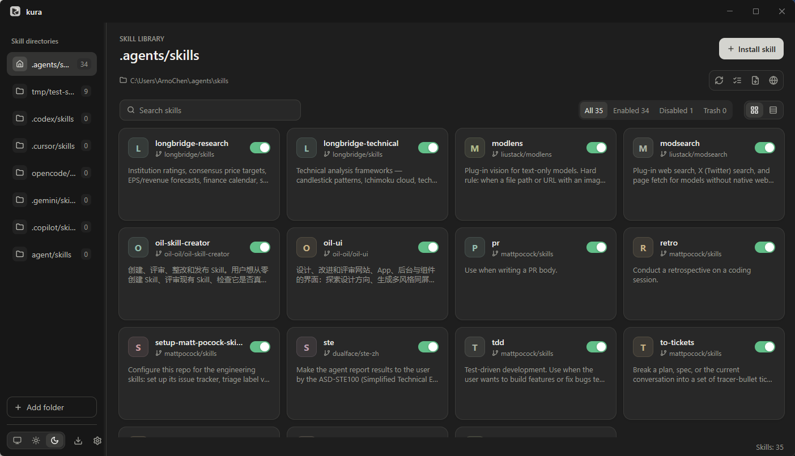

# kura

一个桌面技能管理器（agent skills manager），用 [MyGo](https://github.com/egoist/mygo) 的原生 `ui` 包构建：没有 webview，不需要 Node，也不需要 Bun。

[English README](README.md)



[查看浅色界面](docs/screenshot-light.png)

## 它能做什么

- **同时管理多个技能根目录**。默认根目录是 `~/.agents/skills`，永远排在列表第一位；任何其他文件夹都能在界面里加进来。每个根目录有各自的停用/回收站/快照数据，不同根目录里的同名技能互不干扰；切换目录会保留各自的搜索、筛选和浏览位置。
- **安装技能**：来源可以是 GitHub 仓库（`owner/repo` 或粘贴链接，可指定子目录、分支与安装名），也可以是本地文件夹。仓库里的技能会被自动发现，一个仓库能一次装上多个；其中一个失败不影响其余。默认名字取 `SKILL.md` 里的 `name` 字段。
- **浏览技能市场**：查看 skills.sh 榜单，按技能名或来源仓库搜索已加载的条目，并安装到当前目录。
- **启用与停用靠移动**，不是复制，也不是技能里的标记位：目录在根目录与 `~/.kura/disabled/` 之间往返。移除则是移进 `~/.kura/trash/`，随时可以恢复；从回收站永久删除要先确认，并且会先写一份内容快照。
- **按 git 对象哈希检查更新**，不看时钟也不看文件时间：上游没变就一个文件都不下载。同一个仓库的技能共用一次 clone；已装内容被本地手改过的技能会明确提示。可以勾选要更新的技能，查看每项结果，并只重试失败项。
- **查看技能全文并翻译**。默认使用免密钥的 Google 翻译，也可在设置中选择实验性的微软翻译或自定义 OpenAI 兼容 API。长文显示翻译进度，可以停止后继续，失败时保留已完成段落。免费服务的可用性取决于地区与服务状态；无法连接时保留原文，可手动切换服务。译文只在内存里，不修改 `SKILL.md`。
- **查看与恢复历史快照**。在技能详情中查看历史版本与逐文件差异，确认后恢复；恢复前会保存当前版本。
- **中英双语界面**。文案用 MyGo 官方 ARB catalogs（`locales/`）管理，连 MyGo 自己的菜单、文件对话框与控件也跟着变中文或英文。第一次打开跟随系统语言（系统是中文就用中文，其余一律英文），也可以在设置弹窗里固定；命令行有 `--lang` 与 `KURA_LANG`。
- **三栏窗口**（技能目录、技能卡片、详情）。栏宽可拖，目录列表可拖动排序，技能区可切换卡片网格与列表，还有搜索框和带计数的 全部/启用/停用/回收站 筛选。右键菜单使用系统原生菜单。
- **应用自更新**，由 MyGo 更新器完成：应用菜单里有「检查更新…」。后台每天还会自动检查一次，查到新版本只在左栏「检查更新」按钮上亮一个蓝点，从不自己弹出窗口；下载的更新包通过 Ed25519 验签后才安装。
- **自动发现本机 agent 目录**。启动时把已经存在的全局技能目录加进列表（Claude Code、 Codex、Cursor、Gemini CLI、Pi 等，见 `internal/store/agentdirs.go`）；你从列表里移除过的目录不会再被加回来。

## 安装

到 [Releases](https://github.com/ArnoChenFx/kura/releases) 页面下载。发布产物的命名如下：

- Windows：`kura.Setup.<version>.amd64.exe`（按用户安装的安装器）、`kura.exe`（免安装）
- macOS：`kura.<version>.arm64.dmg`、`kura.<version>.amd64.dmg`
- Linux：`kura_<version>_{amd64,arm64}.deb`、`kura-<version>-linux-<arch>.tar.gz`，或 `install.sh`（为当前用户装到 `~/.local/kura.app`，不需要 root）

这些产物装的是窗口版；命令行是独立二进制，从源码构建（见下一节），或者取 CI 每次运行附带的 `kura-cli-<os>-<arch>` artifact。

## 命令行

`cmd/kura` 是与窗口版共用同一套 store 的无界面 CLI；`kura help` 打印完整用法。

```sh
kura list                  # 或 scan：根目录里的全部技能及其状态
kura add --local PATH      # 从本地文件夹安装
kura add --github owner/repo [--sub-path P] [--ref R] [--name N]
kura update NAME           # 按记录的来源重新拉取（先快照）
kura update --check NAME   # 预览会改什么；--all 检查全部技能
kura disable NAME          # 也支持 enable / remove / restore
kura import-meta           # 只适用于默认根目录；读 ~/.agents/.skill-lock.json
kura doctor                # 只读体检
```

退出码：`0` 成功，`1` 操作失败，`2` 用法错误，`3` `doctor` 发现问题或 `update --check` 发现有待更新。每个命令都支持 `--json`（出错时错误以 `{"error": "..."}` 输出到 stderr）以及 `--root` / `--home`（或环境变量 `KURA_ROOT` / `KURA_HOME`）；JSON 形状见 [docs/note/cli-json-shape.md](docs/note/cli-json-shape.md)。

## 文件放在哪

| 路径 | 内容 |
| --- | --- |
| `~/.agents/skills/` | 默认技能根目录（Windows：`%USERPROFILE%\.agents\skills`） |
| `~/.kura/config.json` | 追加的根目录、外观（`theme`）、技能区排列（`view`） |
| `~/.kura/disabled/`、`trash/<skill>/<stamp>/`、`snapshots/<skill>/<stamp>/` | 已停用的技能、已移除的技能（可恢复），以及更新前与移除前写下的快照 |
| `~/.kura/roots/<id>/` | 每个追加根目录自己的那三个目录；`<id>` 是规范化路径 SHA-256 的前 12 位十六进制 |
| `~/.kura/settings.json` | 翻译服务、全局目标语言，以及可选的自定义 API 地址、密钥与模型 |
| `~/.agents/.skill-lock.json` | `kura import-meta` 的只读输入；kura 绝不重写它 |
| `<skill>/.kura-meta.json` | 每个技能的元数据：来源、commit 与树哈希、时间、内容哈希 |

`settings.json` 里的翻译 API 密钥是**明文**保存的（权限 `0600`）：这是本地单人应用刻意选的方案。**不要把它用在公用机器上。**

## 从源码构建

需要 Go 1.27 或更新（`go.mod` 写的是 `go 1.27.2`），除此之外什么都不需要：没有前端构建步骤，Node、Bun、npm 一概不参与。

```sh
go build .            # 窗口版
go build ./cmd/kura   # 无界面 CLI
go tool mygo build    # 打包；交叉打包用 -platform windows/amd64 之类

gofmt -l .            # CI 会跑的检查——改动应该让这些保持全绿
go vet ./...
go tool mygo vet .
go test ./...
CGO_ENABLED=0 go test ./...
CGO_ENABLED=0 go build ./...
```

## 参与开发与文档

[AGENTS.md](AGENTS.md) 是仓库的工程约定（包边界、UI 线程契约、验证要求、测试隔离）； [REQUIREMENTS.md](REQUIREMENTS.md) 是 kura 必须做到什么，含边界情况与非目标。 [CHANGELOG.md](CHANGELOG.md) 是发布说明的来源，且每个版本都要有 `## <版本号>` 标题，因为更新器会展示那一小节。开发笔记都在 [docs/note/](docs/note/)。
